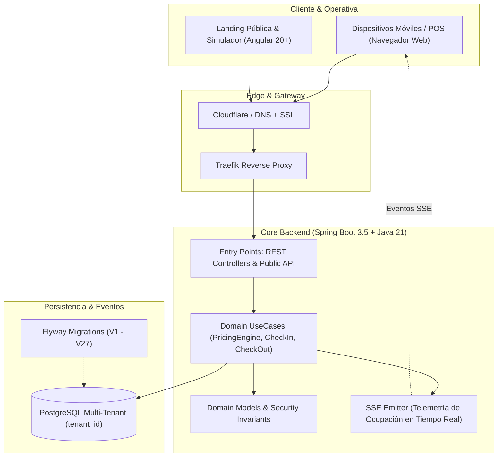

## 1. 📋 Resumen Ejecutivo

**Nivo** es una plataforma SaaS cloud-native multi-tenant en producción diseñada para modernizar y digitalizar la operación integral de estacionamientos comerciales e independientes. Su propuesta de valor central radica en permitir la transición desde esquemas tradicionales basados en talonarios de papel y hojas de cálculo manuales hacia un control 100% digital en menos de 2 minutos, eliminando por completo la necesidad de invertir en hardware propietario, tótems de acceso o servidores locales dedicados.

La plataforma articula un backend de alto rendimiento desarrollado en **Java 21** con **Spring Boot 3.5.4** bajo principios rigurosos de **Clean Architecture**, junto con un frontend reactivo en **Angular 20+** potenciado por una librería de componentes de diseño propia (`@nivo-sass/design-system`). Nivo resuelve con precisión matemática el cálculo de tarifas complejas en tiempo real mediante su motor desacoplado (`PricingEngine`), sincroniza el estado de ocupación de celdas mediante telemetría reactiva vía **Server-Sent Events (SSE)** y proporciona vouchers digitales accesibles al usuario final a través de códigos QR y WhatsApp.

<div class="table-wrapper">

| **Metadato** | **Detalle** |
|--------------|-------------|
| **Categoría** | Multi-Tenant SaaS / Movilidad Urbana & Parking Tech |
| **Estado Actual** | En Producción ([nivo.angelcorzo.dev](https://nivo.angelcorzo.dev)) |
| **Rol** | Creador & Full-Stack Architect |
| **Backend** | Java 21, Spring Boot 3.5.4, Clean Architecture, PostgreSQL + Flyway (27 migraciones), Server-Sent Events (SSE) |
| **Frontend** | Angular 20+, Standalone Components, Tailwind CSS, @nivo-sass/design-system, Lucide Icons |
| **Infraestructura** | Docker, Traefik Reverse Proxy, Cloudflare SSL/DNS, Linux VPS |
| **Landing & Demo** | [https://nivo.angelcorzo.dev](https://nivo.angelcorzo.dev) |
| **Repositorio GitHub** | [https://github.com/juniorcorzo/nivo](https://github.com/juniorcorzo/nivo) |

</div>

---

## 2. 🎯 Desafío Operativo y Técnico

### El Problema del Papel en Estacionamientos Tradicionales

En América Latina y mercados emergentes, la inmensa mayoría de parqueaderos de rotación y lotes independientes operan mediante recibos impresos en talonarios de papel, sellos de tinta y anotaciones a mano en cuadernos de contabilidad. Esta operativa manual genera fricciones severas y vulnerabilidades estructurales:

- **Fugas directas de ingresos**: El redondeo discrecional y los errores aritméticos al calcular minutos transcurridos y fracciones horarias causan pérdidas financieras recurrentes en cada jornada.
- **Vulnerabilidad al fraude interno**: El extravío intencional de boletos, el cobro sin emisión de comprobante y la manipulación de horas de entrada/salida son problemas endémicos difíciles de auditar con registros físicos.
- **Inexistencia de auditoría histórica**: Los talonarios físicos se deterioran, se pierden o resultan imposibles de analizar para calcular métricas básicas como ocupación promedio, picos de demanda o ingresos consolidados por turno.
- **Disputas con clientes**: La falta de transparencia en la hora exacta de ingreso o el monto a cobrar desencadena discusiones frecuentes que ralentizan la salida vehicular y deterioran la experiencia del usuario.

### Barreras de Entrada de Soluciones Existentes

Las alternativas de automatización convencionales en el mercado de estacionamientos imponen barreras de entrada técnicas y económicas casi insuperables para operadores independientes:

1. **Inversión intensiva en hardware propietario**: Tótems de expedición de tickets, barreras vehiculares automáticas con PLC, sensores ultrasónicos por celda y lectores de tarjetas RFID de coste prohibitivo.
2. **Infraestructura on-premise frágil**: Obligación de instalar un servidor físico en el establecimiento, sujeto a cortes de energía, fallos de disco y sin respaldos automatizados.
3. **Plazos de implementación prolongados**: Despliegues que toman entre 3 y 8 semanas, requiriendo obra civil, cableado estructurado y capacitación presencial costosa.

### Restricciones Clave y Requisitos No Funcionales

Para democratizar la tecnología de estacionamientos de forma económicamente viable, Nivo se diseñó bajo cuatro restricciones no negociables:

- **Aislamiento Multi-Tenant Absoluto**: Separación lógica estricta a nivel de datos (`tenant_id`) en cada consulta, comando transaccional y flujo en memoria, garantizando que un establecimiento jamás pueda acceder ni filtrar información de otro inquilino.
- **Telemetría Reactiva Eficiente en Tiempo Real**: Notificación instantánea de cambios en la ocupación y estados de tickets hacia las interfaces de operador sin saturar el servidor mediante polling HTTP innecesario.
- **Operatividad 100% Hardware-Agnostic**: Capacidad de operar fluidamente desde cualquier navegador web moderno en smartphones de gama baja o media, tablets Android/iOS o PCs de escritorio existentes, sin instalación de drivers ni software propietario.
- **Protocolo de Resiliencia para Vehículos sin Placa y Vouchers Digitales**: Flujo de contingencia automatizado para motocicletas o bicicletas sin matrícula (`SP-xxxx`) y entrega inmediata de tickets al conductor mediante código QR dinámico y redirección nativa a WhatsApp.

---

## 3. 🏗️ Solución Implementada

### Estructura Monorepo y Clean Architecture

Para garantizar un ciclo de vida evolutivo sin acoplamientos técnicos perjudiciales, Nivo se estructuró como un monorepo que separa con precisión las responsabilidades del backend, el frontend, las librerías compartidas y la infraestructura de despliegue:

```
Nivo/
├── apps/
│   ├── api/                            # Backend Spring Boot 3.5.4 en Java 21 (Clean Architecture)
│   │   └── src/main/java/dev/angelcorzo/nivo/
│   │       ├── domain/                 # Core de negocio independiente de frameworks
│   │       │   ├── model/              # Entidades puras, VOs y contratos de gateway (parkinglots, tickets, rates, tenant)
│   │       │   └── usecase/            # Casos de uso atómicos (CalculateRateUseCase, SimulateRateUseCase, CheckinVehicleUseCase)
│   │       ├── infrastructure/         # Implementaciones tecnológicas concretas
│   │       │   ├── adapter/            # Adaptadores externos: JPA (PostgreSQL + Flyway), EventBus, Pagos, Notificaciones
│   │       │   ├── entrypoint/         # Controladores REST (públicos y administrativos) y WebSockets/SSE
│   │       │   └── security/           # Spring Security, JWT, Rate Limiting (PublicApiRateLimitFilter)
│   │       └── config/                 # Inyección de dependencias y beans (UseCasesConfig, AppConfig)
│   └── web/                            # Frontend Web en Angular 20+ (Standalone Components, Signals, Tailwind CSS)
├── libs/
│   └── design-system/                  # Librería @nivo-sass/design-system (componentes accesibles WCAG 2.1 AA)
├── database/                           # Esquema relacional SQL y modelo de datos multi-tenant (scheme.sql, DATABASE_MODEL.md)
└── deployment/                         # Orquestación con Docker Compose, Traefik, Grafana y Prometheus
```

- **`apps/api` (Backend Clean Architecture)**:
  - **`domain/model`**: Define las entidades centrales del negocio (`ParkingLots`, `ParkingTickets`, `RatePolicy`, `Tenant`, `Slot`) y Value Objects (`Address`, `Coordinates`, `OperatingHours`) como clases Java puras, totalmente aisladas de frameworks, sin anotaciones JPA `@Entity` ni dependencias de Spring.
  - **`domain/usecase`**: Contiene la lógica orquestadora y las reglas invariantes (`CalculateRateUseCase`, `SimulateRateUseCase`, `CheckinVehicleUseCase`, `CheckOutVehicleUseCase`, `BatchUpsertSlotsUseCase`). No tiene acoplamiento con la persistencia ni con el protocolo HTTP.
  - **`infrastructure/adapter`**: Implementa los contratos definidos en el dominio: mapeo a entidades JPA para PostgreSQL, gestión transaccional, eventos internos y emisión reactiva de telemetría.
  - **`infrastructure/entrypoint`**: Expone las interfaces REST (`rest/publicapi`, `rest/rates`, `rest/parkingtickets`, `rest/slot`) y canales en tiempo real para clientes web y operadores de cabina.
  - **`infrastructure/security`**: Control de acceso con Spring Security y JWT, contexto de seguridad y rate limiting token bucket (`PublicApiRateLimitFilter`).
- **`apps/web` (Frontend)**: Aplicación web moderna construida en **Angular 20+** basada en Standalone Components y Signals para reactividad granular sin sobrecarga de módulos.
- **`libs/design-system`**: Librería de componentes UI reutilizables (`@nivo-sass/design-system`) construida con Angular, tokens centralizados en CSS variables y validación visual en Storybook.
- **`database` & `deployment`**: Gestión de esquemas PostgreSQL con aislamiento `tenant_id` y contenedores Docker Compose con Traefik como proxy inverso y terminación SSL.

### Diagrama Arquitectónico End-to-End



---

## 4. ⚙️ Implementaciones e Innovaciones Clave

### 4.1 Motor de Tarifas Dinámicas (PricingEngine) & Simulador Público

El núcleo de rentabilidad de cualquier estacionamiento reside en la flexibilidad de sus políticas tarifarias. En Nivo, el `PricingEngine` está implementado como un componente de dominio determinista capaz de evaluar combinaciones complejas de cobro:

- **Estructuración por Tipo de Vehículo**: Diferenciación tarifaria para automóviles, motocicletas, bicicletas y vehículos de carga pesada.
- **Segmentación Temporal**: Modelado de tarifas por hora completa, fracciones de 15 minutos, tarifas planas nocturnas y esquemas de tarifa día.
- **Minutos de Gracia Parametrizables**: Tolerancia de cortesía (por ejemplo, los primeros 10 o 15 minutos sin costo para recoger o dejar pasajeros) aplicada de manera automática y auditable.
- **Invariantes Financieras**: Redondeos exactos implementados con `BigDecimal` y validaciones estrictas para impedir cobros negativos o inconsistencias de zona horaria.

```java
public record PricingCalculationResult(
    BigDecimal totalAmount,
    long billableMinutes,
    long gracePeriodAppliedMinutes,
    BigDecimal appliedHourlyRate,
    LocalDateTime entryTime,
    LocalDateTime exitTime
) {}

public class CalculateParkingRateUseCase {
    public PricingCalculationResult execute(
        Ticket ticket, 
        RatePolicy policy, 
        LocalDateTime departureTime
    ) {
        long totalMinutes = Duration.between(ticket.getEntryTime(), departureTime).toMinutes();
        
        if (totalMinutes <= policy.getGraceMinutes()) {
            return new PricingCalculationResult(
                BigDecimal.ZERO, totalMinutes, totalMinutes, policy.getBaseRate(), 
                ticket.getEntryTime(), departureTime
            );
        }
        
        long billableMinutes = totalMinutes;
        BigDecimal calculatedTotal = policy.computeCharge(billableMinutes);
        
        return new PricingCalculationResult(
            calculatedTotal, billableMinutes, 0L, policy.getBaseRate(),
            ticket.getEntryTime(), departureTime
        );
    }
}
```

#### Simulador Público para Adquisición de Clientes en la Landing

Para acelerar el embudo de ventas y generar confianza inmediata, Nivo expone un endpoint público desacoplado (`/api/v1/public/simulator/calculate`) consumido directamente por el widget interactivo de la landing page ([https://nivo.angelcorzo.dev](https://nivo.angelcorzo.dev)). 

Los dueños de parqueaderos pueden ingresar el tipo de vehículo, tiempo de estadía estimado y sus tarifas base para visualizar al instante la descomposición matemática exacta del cobro, demostrando en vivo la precisión del motor antes de completar el registro.

### 4.2 Telemetría Reactiva con Server-Sent Events (SSE)

Para mantener actualizadas las pantallas de control de los operarios en los accesos vehiculares, se requería un mecanismo de transmisión en vivo del aforo de celdas y del estado de los tickets activos.

#### ¿Por qué SSE frente a WebSockets?

<div class="table-wrapper">

| Criterio | WebSockets | Server-Sent Events (SSE) en Nivo |
|----------|------------|-----------------------------------|
| **Direccionalidad** | Bidireccional (Full-Duplex) | Unidireccional (Server-to-Client) |
| **Protocolo de Transporte** | TCP / Protocolo `ws://` propietario | HTTP estándar (`text/event-stream`) |
| **Sobrecarga de Servidor** | Alto consumo de memoria para stateful session | Extremadamente ligero, reutiliza HTTP/2 |
| **Reconexión Automática** | Requiere lógica manual en cliente | Nativa en navegadores vía API `EventSource` |
| **Compatibilidad con Proxies** | Requiere configuración especial en Edge/CDN | Atraviesa Traefik y Cloudflare de forma nativa |
| **Adecuación al Negocio** | Excesivo para notificar eventos de aforo | Óptimo: el servidor únicamente notifica cambios de estado |

</div>

El adaptador de infraestructura en Spring Boot gestiona emisores `SseEmitter` particionados por `tenant_id`, permitiendo enviar eventos específicos de check-in, check-out y alerta de capacidad sin que los clientes tengan que saturar la API con peticiones recurrentes de polling:

```java
@Component
public class ParkingSseEmitterAdapter implements OccupancyEventGateway {
    private final Map<String, List<SseEmitter>> tenantEmitters = new ConcurrentHashMap<>();

    @Override
    public void notifyOccupancyChanged(String tenantId, OccupancySnapshot snapshot) {
        List<SseEmitter> emitters = tenantEmitters.getOrDefault(tenantId, Collections.emptyList());
        emitters.forEach(emitter -> {
            try {
                emitter.send(SseEmitter.event()
                    .name("occupancy-update")
                    .data(snapshot));
            } catch (IOException ex) {
                emitter.complete();
            }
        });
    }
}
```

### 4.3 Design System Propio (@nivo-sass/design-system) y Frontend Angular 20+

El frontend de Nivo fue concebido para operar en entornos hostiles: pantallas bajo la luz solar directa, operarios con manos ocupadas y conexiones móviles intermitentes en sótanos de estacionamientos.

- **Arquitectura Standalone & Angular Signals**: Eliminación total de `NgModules` heredados en favor de componentes standalone modernos y Signals para la gestión de estado reactivo local.
- **ChangeDetectionStrategy.OnPush**: Implementado en el 100% de los componentes del catálogo para eliminar ciclos innecesarios de verificación de cambios, logrando tasas sostenidas de 60 FPS en dispositivos móviles de gama de entrada.
- **Tokens de Diseño y Accesibilidad WCAG 2.1 AA**: Paleta de color optimizada con contrastes cromáticos superiores a 4.5:1 en elementos de texto y áreas de toque táctil mínimas de 48x48px para facilitar el uso ágil en pantallas táctiles.

### 4.4 Persistencia y Evolución de Datos con Flyway

El esquema relacional en PostgreSQL está versionado rigurosamente mediante **27 migraciones consecutivas con Flyway** (`V1` a `V27`). Esta disciplina garantiza:

1. **Aislamiento Multi-Tenant**: Inclusión de índices compuestos `(tenant_id, ...)` en todas las tablas transaccionales (`tickets`, `vehicles`, `rate_policies`, `audit_logs`).
2. **Trazabilidad de Auditoría**: Registro de timestamps de entrada, salida, cajero operador e identificador de transacción financiera.
3. **Cero Downtime**: Despliegues continuos automatizados donde las migraciones hacia adelante no rompen la versión activa en ejecución.

---

## 5. 🚀 Resultados y Métricas en Producción

Nivo opera activamente en producción, validando su estabilidad arquitectónica y su propuesta comercial:

<div class="table-wrapper">

| Métrica / Dimensión | Resultado en Producción | Impacto Tangible |
|---------------------|-------------------------|------------------|
| **Disponibilidad del Sistema** | 99.9% uptime continuo | Operación ininterrumpida en turnos diurnos y nocturnos |
| **Tiempo de Onboarding** | < 2 minutos por establecimiento | Habilitación inmediata sin visitas técnicas presenciales |
| **Coste en Hardware Propietario** | $0 USD | Ahorro del 100% en tótems y servidores dedicados |
| **Latencia de Cálculo Tarifario** | < 15 ms en backend | Cobro instantáneo en ventanilla de salida |
| **Aislamiento de Tenants** | 100% verificado | Cero incidentes de fuga de datos entre inquilinos |
| **Migraciones de Base de Datos** | 27 migraciones continuas sin downtime | Evolución continua sin interrupción del servicio |

</div>

### Hitos de Despliegue en Producción

- **Producción Operativa**: Plataforma y landing page desplegadas en [https://nivo.angelcorzo.dev](https://nivo.angelcorzo.dev) bajo arquitectura de contenedores Docker orquestada con Traefik y certificada por Cloudflare.
- **Democratización Tecnológica**: Establecimientos con infraestructuras modestas ahora gestionan cientos de vehículos diarios utilizando smartphones básicos conectados a redes móviles 4G.
- **Reducción de Huella de Carbono**: Eliminación de miles de talonarios de papel térmico no reciclable al mes mediante la digitalización vía tickets con código QR y WhatsApp.

---

## 6. 💡 Lecciones Aprendidas y Conclusiones

### La Ventaja de Clean Architecture a Largo Plazo

La adopción de Clean Architecture representó un esfuerzo inicial de estructuración que pagó dividendos significativos a medida que el producto evolucionó. Al mantener el modelo de dominio y los casos de uso estrictamente aislados de Spring Boot y PostgreSQL, fue posible:

1. Modificar y refactorizar el `PricingEngine` sin tocar una sola línea de código de los controladores ni de las capas de persistencia.
2. Incorporar endpoints públicos para el simulador reutilizando con total seguridad las mismas clases de caso de uso del core.
3. Escribir pruebas unitarias ultra rápidas sin necesidad de levantar contextos pesados de Spring Boot, asegurando una cobertura del 100% en las reglas financieras de facturación.

### Disciplina con Organic Driven Development (ODD) y TDD

La construcción de una plataforma SaaS para el mundo real requiere rechazar la sobreingeniería estéril y priorizar la resolución certera de problemas operativos concretos. La combinación de **TDD (Test-Driven Development)** para las reglas del motor de tarifas junto con **ODD (Organic Driven Development)** permitió entregar una herramienta en producción resiliente, segura y financieramente transformadora para la pequeña y mediana empresa.

---

## 📊 Enlaces y Recursos del Proyecto

- **Landing Page & Simulador en Vivo**: [https://nivo.angelcorzo.dev](https://nivo.angelcorzo.dev)
- **Repositorio de Código Fuente**: [https://github.com/juniorcorzo/nivo](https://github.com/juniorcorzo/nivo)
- **Documentación de Arquitectura**: Monorepo con Clean Architecture, especificaciones OpenAPI y suites de pruebas automatizadas.
